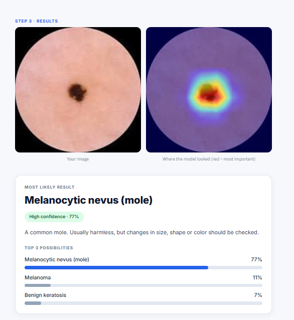
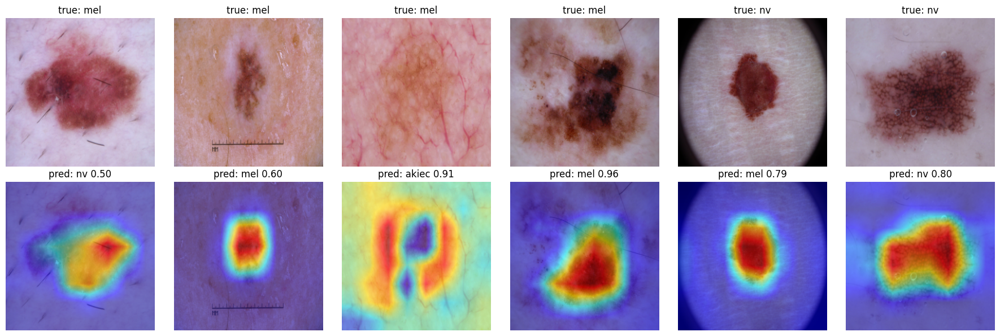
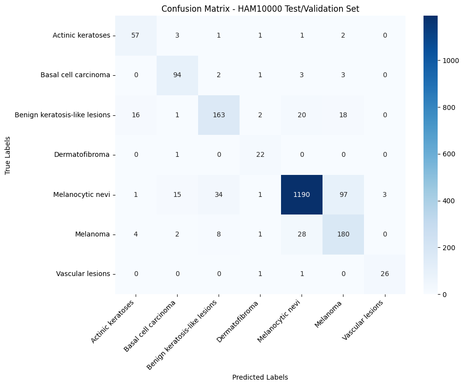

# Skin Lesion Classifier (HAM10000)

Explainable 7-class skin lesion classification with transfer learning (EfficientNet-B0), Grad-CAM heatmaps and a deployed Streamlit app.

**[Live demo](https://skin-lesion-classification-6x.streamlit.app)** · [Training notebook](skin_lesion_classification.ipynb)


## Overview

The app takes a dermoscopy image and returns the most likely lesion type out of seven, a confidence level, the top 3 possibilities, and a Grad-CAM heatmap showing which part of the image drove the prediction. Two detection modes let the user trade overall accuracy against melanoma sensitivity.

| Input and result | Grad-CAM examples |
|---|---|
|  |  |

## Dataset

[HAM10000](https://www.kaggle.com/datasets/kmader/skin-cancer-mnist-ham10000): 10,015 dermoscopy images across 7 classes (`akiec`, `bcc`, `bkl`, `df`, `mel`, `nv`, `vasc`). The data is heavily imbalanced: about two thirds of the images are benign nevi (`nv`), while `df` and `vasc` have only about 20 test images each.

## Method

- **Leakage-safe split:** the same lesion can appear in several images, so the data is split by `lesion_id` (70 / 15 / 15, stratified by class). Many public notebooks split by image, which inflates the scores, so the numbers here are lower but more honest.
- **Transfer learning:** ImageNet-pretrained ResNet50, EfficientNet-B0 and MobileNetV2, fine-tuned in two stages (train the new head first, then unfreeze the top layers at a low learning rate).
- **Imbalance handling:** class-weighted cross-entropy and augmentation (flips, rotation, color jitter). Models were selected by validation macro-F1, not accuracy.
- **Final model (round 2b):** EfficientNet-B0 at 256 px, full fine-tuning with a lower learning rate for the backbone (2e-5) than the head (1e-4), square-root class weights, cosine schedule, and flip test-time augmentation.
- **Explainability:** Grad-CAM on the last convolutional block.
- **Training:** PyTorch on a free Colab T4 GPU, seed 42.

## Results

### Round 1: backbone comparison (224 px)

| Model | Accuracy | Macro-F1 | Melanoma recall | Params |
|---|---|---|---|---|
| ResNet50 | 0.764 | 0.623 | 0.582 | 23.5M |
| EfficientNet-B0 | 0.727 | 0.627 | 0.703 | 4.1M |
| MobileNetV2 | 0.697 | 0.597 | 0.618 | 2.2M |

<!-- If your retrained round 1 numbers differ, replace the three rows above. -->

EfficientNet-B0 had the best macro-F1 and melanoma recall with about 6x fewer parameters than ResNet50, so it was chosen for further tuning.

### Final model (EfficientNet-B0, round 2b, with TTA)

| Mode | Accuracy | Macro-F1 | Melanoma recall |
|---|---|---|---|
| Standard (balanced) | 0.822 | 0.709 | 0.648 |
| Cautious (melanoma boost) | 0.758 | 0.694 | 0.885 |

The Cautious mode multiplies the melanoma probability by a factor chosen on the **validation** set only, then evaluated once on the held-out test set. It misses far fewer melanomas at the cost of more false alarms, which is the cheaper error in a screening setting.

### What didn't work first

My first tuning attempt (full unfreezing, label smoothing and full inverse-frequency class weights together) over-corrected for the rare classes: accuracy dropped to 0.591 and macro-F1 to 0.524. The confusion matrix showed benign nevi being pushed into rare classes, with precision for `df` around 0.05. Softening the class weights, removing label smoothing and using a lower backbone learning rate fixed it (0.822 / 0.709).



## Limitations

- `df` and `vasc` have only about 20 test images each, so their per-class scores vary a lot between runs.
- Single training run (seed 42), so small differences between models (for example macro-F1 0.623 vs 0.627) are within noise.
- HAM10000 comes from a small number of clinics and has limited skin-tone diversity, so performance on other populations and devices is unknown.
- Grad-CAM shows where the model looked, not that its reasoning is clinically correct. In low-contrast lesions the attention can be diffuse and the model can be confidently wrong.
- Trained on dermoscopy images only. Phone photos will not work reliably.

## Run locally

```bash
git clone https://github.com/<your-username>/<repo-name>.git
cd <repo-name>
pip install -r requirements.txt
streamlit run app.py
```

## Repository structure

```
app.py                       Streamlit app
effb0_r2b_s42.pt             Final model weights
requirements.txt
skin-lesion-classification.ipynb   Training and evaluation notebook
samples/                     Sample images for the demo
assets/                      README images and demo GIF
.streamlit/config.toml       App theme
```

## Tech stack

PyTorch, torchvision, scikit-learn, pytorch-grad-cam, Streamlit, Google Colab.

## Data and license

Dataset: Tschandl, P., Rosendahl, C. & Kittler, H. *The HAM10000 dataset, a large collection of multi-source dermatoscopic images of common pigmented skin lesions.* Sci. Data 5, 180161 (2018). The dataset page lists the license as CC BY-NC-SA 4.0, so this project is for non-commercial, educational use.

## Author

Deepak Kumar · [LinkedIn](https://www.linkedin.com/in/deepakkumar915176/)
